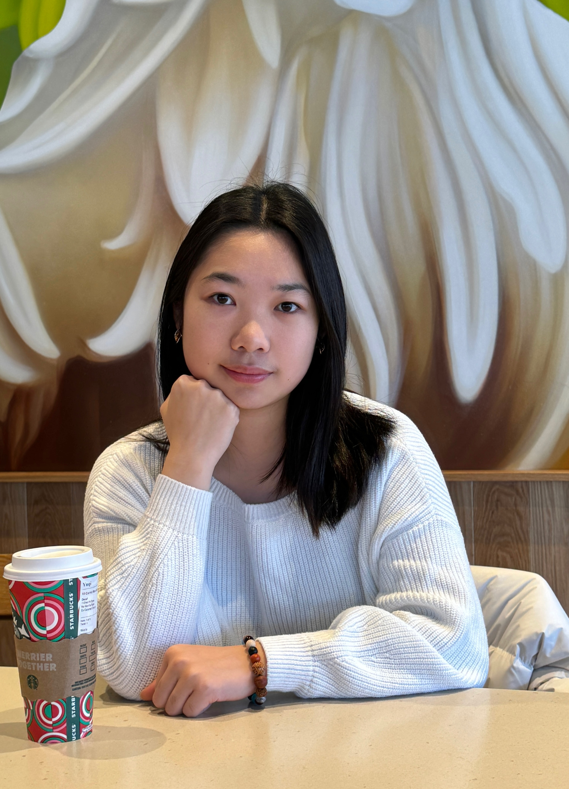

```{r setup, include=FALSE}
knitr::opts_chunk$set(echo = FALSE, warning = FALSE, message = FALSE)
```

```{=html}
<style>
:root { --deep: #244e4a; --blue: #277b9d; --green: #67a994; --pale: #eff9f5; --line: #dbece8; --ink: #304746; }
body { color: var(--ink); background: #f6fbff; transition: background-color .25s ease; }
* { box-sizing: border-box; }
.d-article { max-width: 900px; }
.d-article p, .d-article li { color: var(--ink); line-height: 1.7; }
.d-article a { color: var(--blue); text-decoration-thickness: 1px; text-underline-offset: 3px; }
.d-article a:hover { color: var(--deep); }
.d-article h2 { color: var(--deep); border-bottom: 1px solid var(--line); padding-bottom: .35rem; margin-top: 3rem; }
.d-article h3 { color: var(--deep); margin-bottom: .3rem; }
.hero { display: flex; align-items: center; gap: 2rem; width: 100%; min-width: 0; padding: 2rem; margin: 1.4rem 0 2.5rem; border-radius: 22px; background: linear-gradient(130deg, #e8f5fd, #f1f9ff); border: 1px solid #d9eaf4; box-shadow: 0 12px 35px rgba(36,78,74,.06); }
.hero > div { flex: 1; min-width: 0; }
.hero p, .hero h2 { overflow-wrap: anywhere; }
.hero .eyebrow { display: flex; align-items: center; gap: .65rem; color: #397d97; font-weight: 700; letter-spacing: .1em; text-transform: uppercase; font-size: .78rem; }
.site-mark { width: 42px; height: 42px; flex: 0 0 42px; filter: drop-shadow(0 3px 6px rgba(36,78,74,.1)); }
.hero-photo { flex: 0 0 170px; width: 170px; height: 170px; object-fit: cover; border-radius: 50%; border: 5px solid white; box-shadow: 0 6px 20px rgba(36,78,74,.12); }
.hero h2 { margin: 0 0 .5rem; border: 0; padding: 0; }
.hero p { margin: 0 0 .75rem; }
.hero .tags { color: var(--deep); font-size: .88rem; font-weight: 600; margin-bottom: 0; }
.spark { color: var(--green); }
.fun-note { border-left: 4px solid var(--green); background: #f2faf5; border-radius: 0 12px 12px 0; padding: .8rem 1.1rem; margin: 1.3rem 0; }
.entry { border: 1px solid var(--line); border-left: 5px solid #83bdd2; border-radius: 0 13px 13px 0; background: #fff; padding: 1.2rem 1.4rem; margin: 1.4rem 0; box-shadow: 0 5px 18px rgba(36,78,74,.04); }
.entry:nth-of-type(even) { border-left-color: var(--green); }
.entry h3 { margin-top: 0; }
.entry .meta { color: #52716d; font-size: .92rem; margin: 0 0 .55rem; }
.entry ul { margin: .5rem 0 0; padding-left: 1.25rem; }
.entry li { margin-bottom: .4rem; }
.project-tools { color: #52716d; font-size: .92rem; margin: 0 0 .55rem; }
.skills-grid { display: grid; grid-template-columns: repeat(2, minmax(0, 1fr)); gap: .8rem; margin: 1rem 0; }
.skill-box { border: 1px solid var(--line); border-radius: 13px; padding: 1rem 1.2rem; background: #f5fbf9; }
.skill-box strong { color: var(--deep); }
.skill-box p { margin: .3rem 0 0; }
.footer-note { color: #607c76; font-size: .85rem; border-top: 1px solid var(--line); padding-top: 1rem; margin-top: 3rem; }
@media (max-width: 640px) { .hero { flex-direction: column; text-align: center; padding: 1.4rem; gap: 1rem; } .hero .eyebrow { justify-content: center; } .hero-photo { flex-basis: auto; margin: auto; } .skills-grid { grid-template-columns: 1fr; } .entry { padding: 1rem; } }

/* Only the Experience and Projects panels change between the two sides. */
.side-switch { display: flex; flex-wrap: wrap; align-items: center; gap: .6rem; margin: 2.5rem 0 1rem; padding: .9rem 1rem; border: 1px solid #d9e8f4; border-radius: 16px; background: #f2f7fd; }
.switch-label { margin-right: .3rem; color: var(--deep); font-weight: 700; }
.side-button { appearance: none; border: 1px solid #a9d4ca; border-radius: 999px; background: white; color: var(--deep); font: inherit; font-weight: 700; padding: .5rem 1rem; cursor: pointer; transition: background .2s, transform .2s, box-shadow .2s; }
.side-button:hover { transform: translateY(-2px); box-shadow: 0 4px 12px rgba(36,78,74,.12); }
.side-button:focus-visible { outline: 3px solid var(--blue); outline-offset: 3px; }
.side-button.is-active { background: #dceefa; border-color: #82b9d7; }
.side-panel[hidden] { display: none !important; }
body.side-b { background: #f5fcf7; }
body.side-b .hero { background: linear-gradient(130deg, #e7f6ed, #f3fbf5); border-color: #d9ece1; }
body.side-b .hero .eyebrow { color: #3d8872; }
body.side-b .side-switch { background: #f0f9f2; border-color: #d8ecdf; }
body.side-b .side-button.is-active { background: #d9f1e3; border-color: #79b99b; }
@media (max-width: 640px) { .switch-label { width: 100%; } }
</style>
```

```{=html}
<div class="hero">
  
  <div>
    <p class="eyebrow"><svg class="site-mark" role="img" aria-label="Yuqi Peng leaf and book mark" xmlns="http://www.w3.org/2000/svg" viewBox="0 0 64 64">
  <rect x="2" y="2" width="60" height="60" rx="18" fill="#f9fcf7" stroke="#d8eae4" stroke-width="1.5"/>
  <path d="M31 49C32 42 32 36 30 32" fill="none" stroke="#355d58" stroke-width="3.2" stroke-linecap="round"/>
  <path d="M30 34C24 25 19 21 13 18" fill="none" stroke="#355d58" stroke-width="3.2" stroke-linecap="round"/>
  <path d="M30 34C36 25 41 20 49 15" fill="none" stroke="#355d58" stroke-width="3.2" stroke-linecap="round"/>
  <path d="M13 18C14 10 23 10 27 16C25 22 18 24 13 18Z" fill="#a8d5e8"/>
  <path d="M49 15C49 8 41 7 36 12C37 19 44 20 49 15Z" fill="#a5d8b7"/>
  <path d="M20 42C25 40 28 40 31 43C35 40 39 40 44 42" fill="none" stroke="#8abcb1" stroke-width="1.8" stroke-linecap="round"/>
  <circle cx="47" cy="44" r="1.7" fill="#7db7ce"/>
</svg><span>Hello from Chapel Hill <span class="spark">✦</span></span></p>
    <h2>Hi, I'm Yuqi.</h2>
    <p>At UNC Chapel Hill, I move between data science and media, following the small clues that lead to bigger stories. A baseball swing, a survey response, a piece of writing, or a conversation can each open a new way of seeing the world.</p>
    <p class="tags">Data analysis · Statistical modeling · Visual storytelling</p>
  </div>
</div>
```

## About Me

I am pursuing a **B.S. in Data Science** and a **B.A. in Media and Journalism** at UNC Chapel Hill, with a minor in **Statistics & Analytics**. My interests include predictive modeling, data visualization, sports analytics, social media simulation, and mental health.

```{=html}
<div class="fun-note">Outside of class: café discoveries, cooking, traveling, handball, and my ongoing quest to make world's best matcha latte. 🍵</div>
```

I love both the quiet work of finding a pattern and the creative work of giving it meaning. Data teaches me how to ask sharper questions, while media helps me bring the answers into conversation. These are two sides of the same curiosity. Choose a side to explore where each has taken me.

```{=html}
<div class="side-switch" role="group" aria-label="Choose a side of Yuqi's portfolio">
  <span class="switch-label">Explore my work</span>
  <button type="button" class="side-button is-active" data-target="a" aria-pressed="true">A · Data Science</button>
  <button type="button" class="side-button" data-target="b" aria-pressed="false">B · Media</button>
</div>
```

## Experience

```{=html}
<div class="side-panel" data-side="a">
<div class="entry">
<h3>Data Science Intern</h3>
<p class="meta">Sports Analytics Intelligence Lab (SAIL) · Chapel Hill, NC · Aug. 2026 – Present</p>
<ul>
<li>Conduct independent MLB analytics research using pitch-level Statcast and bat-tracking data, examining how bat speed interacts with pitch type, velocity, and location to influence offensive outcomes.</li>
<li>Build and clean multi-season swing-level datasets in R (baseballr, tidyverse) and engineer features capturing pitch characteristics, ball-strike counts, contact outcomes, and offensive value.</li>
<li>Develop regression and interaction models to quantify the bat speed–performance relationship across pitch profiles and game situations, translating results into insights on swing strategy and the contact–power tradeoff.</li>
</ul>
</div>
<div class="entry">
<h3>Quant Research Intern</h3>
<p class="meta">Pengyang Fund Management Co., Ltd. · Beijing, China · June 2026 – July 2026</p>
<ul>
<li>Cleaned and processed cross-sectional CITIC Tier-1 industry and sell-side analyst data dating back to 2011; independently engineered and backtested 100+ alpha factor candidates using Python.</li>
<li>Evaluated factors using IC, Rank IC, ICIR, IR, and Q1–Q5 quintile performance; selected 15+ robust factors, built a factor combination framework, and executed Mean-Variance Optimization to construct 40+ systematic strategy portfolios.</li>
<li>Produced a 7,000+ word Factor Backtesting Report and a 13,000+ word Industry Rotation Strategy Report; primary strategy achieved an annualized return of 12.91%, annualized excess return of 8.50%, and Information Ratio of 0.701.</li>
</ul>
</div>
</div>
<div class="side-panel" data-side="b" hidden>
<div class="entry">
<h3>Data Desk Staffer</h3>
<p class="meta">The Daily Tar Heel · Chapel Hill, NC · Sept. 2025 – Present</p>
<ul>
<li>Collaborate with senior writers to integrate data analysis and visual storytelling into the newsroom.</li>
<li>Identify and evaluate reliable public data sources and clean datasets.</li>
<li>Design clear, engaging data visualizations using Adobe Illustrator, Flourish, and Datawrapper.</li>
<li>Produce 10+ charts and graphics supporting investigative and feature stories.</li>
</ul>
</div>
<div class="entry">
<h3>Digital Content Creator Intern</h3>
<p class="meta">Tencent · Beijing, China · July 2025 – Aug. 2025</p>
<ul>
<li>Contributed to the planning and production of a seven-episode video series exploring human–AI relationships, including creativity, agency, perception, labor, and information structures.</li>
<li>Wrote and translated 5+ articles on digital life and large language models.</li>
<li>Managed and hosted livestreams for the Tencent Research Institute’s official account.</li>
</ul>
</div>
<div class="entry">
<h3>Advertising Intern</h3>
<p class="meta">RedNote · Beijing, China · Dec. 2025 – Jan. 2026</p>
<ul>
<li>Reviewed digital advertisements for compliance with platform policies and regulatory standards.</li>
<li>Helped refine advertisement review guidelines and risk control policies.</li>
<li>Worked with team members to identify compliance risks and improve content moderation processes.</li>
</ul>
</div>

</div>
```

## Projects

```{=html}
<div class="side-panel" data-side="a">
<div class="entry">
<h3>Business Opportunity Discovery &amp; Validation Agent</h3>
<p class="project-tools">Python · Retrieval-Augmented Generation (RAG)</p>
<ul>
<li>Led a team of 9 in developing a Python-based multi-agent system that analyzes users’ skills, resources, constraints, and market demand to identify and validate personalized business opportunities.</li>
<li>Architected 8 specialized AI agents with individual RAG knowledge bases, integrating user profiling, opportunity discovery, risk assessment, and feedback-driven iteration.</li>
<li>Built an interactive demo website that offers opportunity recommendations, business models, risk evaluations, and 7-day market validation plans.</li>
</ul>
</div>
<div class="entry">
<h3>NCAA D1 Basketball Performance Analysis</h3>
<p class="project-tools">Python · pandas · NumPy · Matplotlib · Seaborn · scikit-learn</p>
<ul>
<li>Led a team of 5 analyzing 10 seasons (2013–2023) of NCAA Division I men’s basketball data and identified the top 5 factors contributing to a winning season.</li>
<li>Built correlation matrix, linear regression, and classification tree models to predict wins, reaching 80+% accuracy.</li>
<li>Directed and edited a 4-minute video presentation that made the findings accessible.</li>
</ul>
<p><a href="https://github.com/yuqisme/NCAA-D1-Basketball-Performance-Analysis">View code on GitHub →</a></p>
</div>
<div class="entry">
<h3>Social Media Addiction Analysis</h3>
<p class="project-tools">R · tidyverse · xgboost · ranger</p>
<ul>
<li>Led a 5-student team analyzing survey data from 705 students to identify predictors of social media addiction and poor mental health.</li>
<li>Built and tuned decision tree, logistic regression, and random forest models with train/test splits and cross-validation; identified and corrected data leakage, reaching 89% accuracy for addiction prediction with logistic regression.</li>
<li>Analyzed variable importance to identify addiction, academic interference, social-media-related conflict, and sleep as key predictors of poor mental health.</li>
</ul>
<p><a href="https://github.com/yuqisme/Social-Media-Addiction-Analysis">View code on GitHub →</a></p>
</div>
<div class="entry">
<h3>Carolina Data Challenge · Music Listening Profiles</h3>
<p class="project-tools">Python · PCA · K-means clustering · Survey analysis</p>
<ul>
<li>Analyzed 567 responses from the Music &amp; Mental Health survey to explore how music habits form distinct listener profiles and relate to self-reported well-being.</li>
<li>Encoded 23 listening features, used PCA to reduce them to 18 components retaining 91.9% of variance, and applied K-means to describe six exploratory listener profiles.</li>
<li>Compared the profiles on self-reported mental health measures. Depression scores differed overall across profiles, but no individual pair remained significant after correction for multiple comparisons; the observational analysis does not establish causation.</li>
</ul>
<p><a href="https://github.com/yuqisme/Carolina-Data-Challenge-2026">View code on GitHub →</a></p>
</div>
</div>
<div class="side-panel" data-side="b" hidden>
<div class="entry">
<h3>Planned Parenthood Perception Research</h3>
<p class="meta">Jan. 2026 – Present</p>
<ul>
<li>Led qualitative research, moderating a five-participant focus group and conducting an in-depth interview on college students’ perceptions of Planned Parenthood.</li>
<li>Designed and administered an online survey to complement the interviews with quantitative findings.</li>
<li>Produced four research reports with branding and communication recommendations.</li>
</ul>
</div>
<div class="entry">
<h3>Documentary Production</h3>
<p class="meta">Aug. 2024 – Dec. 2024</p>
<ul>
<li>Produced a three-minute micro-documentary about a former gymnast using Adobe Premiere Pro; the video was published on YouTube.</li>
<li>Built a personal website using WordPress, HTML, and CSS.</li>
<li>Created a digital story portfolio featuring the video, story, and infographics.</li>
</ul>
<p><a href="https://youtu.be/_t6lKZG2F00" target="_blank" rel="noopener noreferrer">Watch the documentary →</a></p>
</div>
</div>
```

## Community Involvement

```{=html}
<div class="entry">
<h3>Parr Center for Ethics</h3>
<p class="meta">Ethics Scholar · UNC-Chapel Hill · Aug. 2025 – Present</p>
<ul>
<li>Organized and hosted 10+ TED-Ed × UNC events open to the student body, facilitating discussions on ethical dilemmas and contemporary issues.</li>
<li>Volunteered as a moderator at regional and national High School Ethics Bowls, supporting ethical reasoning and debate among students.</li>
</ul>
</div>
```

```{=html}
<div class="entry">
<h3>Hussman International Media Committee</h3>
<p class="meta">Core Member · UNC-Chapel Hill · Apr. 2025 – Present</p>
<ul>
<li>Host social events for international faculty, staff, and students at the Hussman School of Journalism and Media, fostering community and cultural exchange.</li>
<li>Coordinate and invite guest speakers, including international alumni, to share their experiences with current students.</li>
</ul>
</div>
```

```{=html}
<div class="entry">
<h3>Carolina Women’s Team Handball Club</h3>
<p class="meta">Historian · UNC-Chapel Hill · Aug. 2024 – Present</p>
<ul>
<li>Played in the 2025 USA Team Handball College Nationals and helped the team win the national championship.</li>
<li>Curate the club’s historical archive by collecting records, media, and key milestones.</li>
<li>Volunteer at UNC football and basketball games.</li>
</ul>
</div>
```

```{=html}
<div class="entry">
<h3>PPE Undergraduate Reading Group</h3>
<p class="meta">Member · UNC-Chapel Hill · Jan. 2026 – Present</p>
<ul>
<li>Participate in weekly discussions of <em>Just Shelter: Gentrification, Integration, Race, and Reconstruction</em> with peers and a faculty discussion leader, exploring housing, gentrification, race, and social justice.</li>
<li>Contribute analysis and dialogue across disciplines, strengthening critical thinking and reasoning skills.</li>
</ul>
</div>
```

## Education

```{=html}
<div class="entry">
<h3>University of North Carolina at Chapel Hill</h3>
<p class="meta">B.S. in Data Science · B.A. in Media and Journalism · Expected May 2028</p>
<p>GPA: 3.971/4.0</p>
<p><strong>Relevant coursework:</strong> Methods and Models of Data Science, Machine Learning, Optimization, Data Structures and Algorithms, Probability, Stochastic Modeling, Discrete Mathematics, Multivariable Calculus, Linear Algebra</p>
</div>
```

```{=html}
<div class="entry">
<h3>Experimental High School Attached to Beijing Normal University</h3>
<p class="meta">Graduated June 2024 · GPA: 98/100</p>
</div>
```

## Skills

```{=html}
<div class="skills-grid">
  <div class="skill-box"><strong>Languages &amp; tools</strong><p>R · Python · Java · SQL · Git · GitHub · R Markdown</p></div>
  <div class="skill-box"><strong>Data science</strong><p>tidyverse · tidymodels · scikit-learn · pandas · NumPy · ggplot2 · seaborn · plotly</p></div>
  <div class="skill-box"><strong>Design &amp; publishing</strong><p>Tableau · LaTeX · HTML/CSS basics</p></div>
</div>
```

```{=html}
<p class="footer-note">Last updated: `r format(Sys.Date(), "%B %Y")`</p>
```

```{=html}
<script>
(function () {
  function selectSide(side) {
    document.querySelectorAll('.side-panel').forEach(function (panel) {
      panel.hidden = panel.getAttribute('data-side') !== side;
    });
    document.querySelectorAll('.side-button').forEach(function (button) {
      var active = button.getAttribute('data-target') === side;
      button.classList.toggle('is-active', active);
      button.setAttribute('aria-pressed', String(active));
    });
    document.body.classList.toggle('side-b', side === 'b');
  }
  function init() {
    document.querySelectorAll('.side-button').forEach(function (button) {
      button.addEventListener('click', function () { selectSide(button.getAttribute('data-target')); });
    });
    var mark = document.querySelector('.site-mark');
    if (mark) {
      var icon = document.createElement('link');
      icon.rel = 'icon';
      icon.type = 'image/svg+xml';
      icon.href = 'data:image/svg+xml,' + encodeURIComponent(new XMLSerializer().serializeToString(mark));
      document.head.appendChild(icon);
    }
    selectSide('a');
  }
  if (document.readyState === 'loading') document.addEventListener('DOMContentLoaded', init);
  else init();
}());
</script>
```
